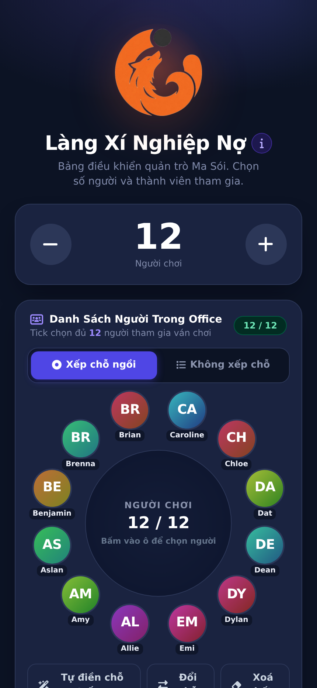
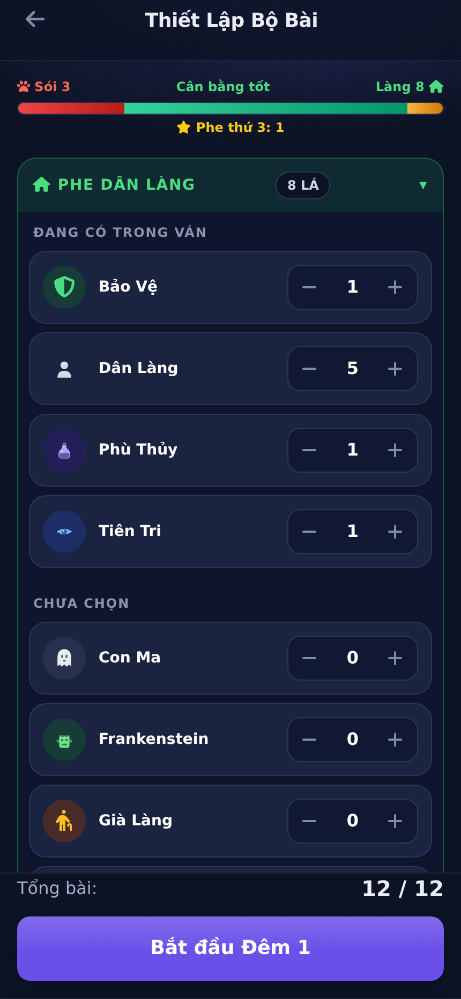
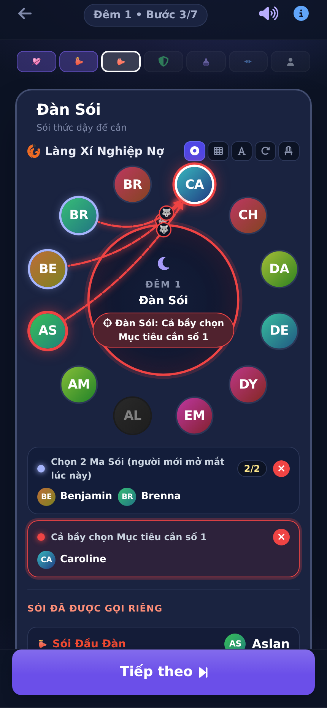
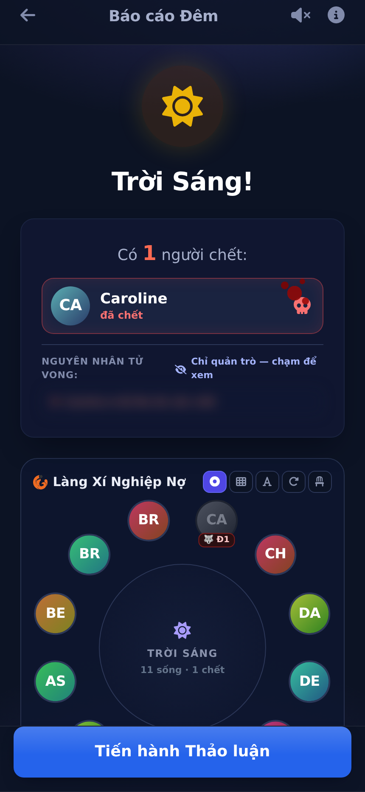
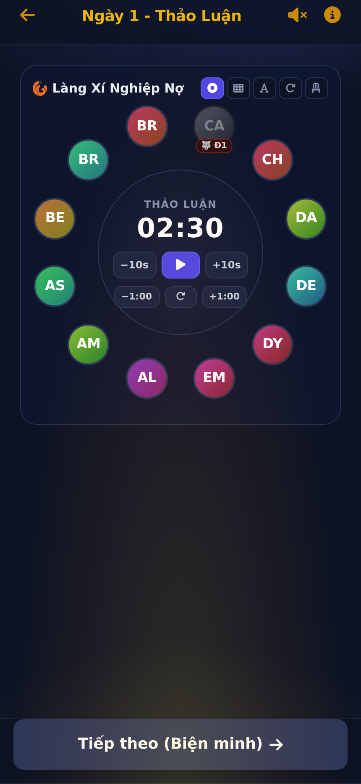

# 🐺 Làng Xí Nghiệp Nợ — Bảng điều khiển Quản trò Ma Sói

Ứng dụng web **chỉ gồm một file** giúp Quản trò dẫn ván **Ma Sói** (theo luật Ultimate Werewolf và luật riêng của nhóm): chọn người chơi, xếp chỗ ngồi quanh bàn, thiết lập bộ bài, gọi vai từng đêm, tự xử lý luật sống/chết và theo dõi toàn bộ ván đấu.
Chạy trên điện thoại, iPad hay máy tính — **không cần cài đặt, không cần máy chủ, không cần tài khoản**.

  
  
  
  
  

## 📑 Mục lục

- [Tính năng chính](#-tính-năng-chính)
- [Bắt đầu sử dụng](#-bắt-đầu-sử-dụng)
- [Hướng dẫn sử dụng chi tiết](HUONG-DAN-SU-DUNG.md)
- [Tuỳ chỉnh cho nhóm của bạn](#️-tuỳ-chỉnh-cho-nhóm-của-bạn)
- [Danh sách vai](#-danh-sách-vai)
- [Lưu ý](#️-lưu-ý)
- [Miễn trừ trách nhiệm](#-miễn-trừ-trách-nhiệm)
- [Giấy phép](#-giấy-phép)

## ✨ Tính năng chính

- **48 vai** chia 3 phe (Dân Làng · Sói · Thứ 3), mỗi vai có biểu tượng riêng, mô tả chức năng và điểm cân bằng.
- **Chơi trên vòng tròn chỗ ngồi**: xếp người chơi đúng vị trí quanh bàn; chạm vào mặt người chơi để điền tên và chọn mục tiêu; mũi tên hiệu ứng từ người giữ vai tới mục tiêu; tự tìm người ngồi cạnh cho Thám Tử, Mất Ngủ, Chất Nhầy, Kẻ Đánh Bom.
- **Gọi vai đúng thứ tự** mỗi đêm, kiểm tra lựa chọn bắt buộc, có ghi chú riêng cho Quản trò, quay lại bước trước bất cứ lúc nào.
- **Tự xử lý luật**: Cặp Đôi, Mẹ Trẻ, Sói Tuyết, Thợ Săn, Frankenstein / Nhân Bản thừa hưởng vai, Sói Con, Sói Đầu Đàn, Sói Trùm, Người Bệnh, Kẻ Bị Nguyền, Phù Thủy Già, Hoàng Tử, Già Làng… và kiểm tra thắng thua, kể cả các phe Thứ 3.
- **Kết quả soi trực quan** bằng lá bài phe và 👍/👎 — chạm để phóng to toàn màn hình đưa cho người chơi xem.
- **Ban ngày**: đồng hồ Thảo luận / Biện minh ngay giữa vòng làng; chạm vào ghế để chọn người bị treo cổ.
- **Báo cáo đêm** với hiệu ứng lật thẻ; nguyên nhân tử vong được che mờ, chỉ Quản trò chạm vào mới xem.
- **Nhật ký sự kiện, dòng thời gian và xuất PDF** tổng hợp ván đấu.
- Nhạc nền, hiệu ứng chuyển cảnh, giữ màn hình luôn sáng, **tự lưu ván** (tải lại trang vẫn chơi tiếp), hoàn tác nhiều bước.

## 🚀 Bắt đầu sử dụng

**Cách 1 — Mở trực tiếp trên máy:** tải file [`index.html`](index.html) về rồi mở bằng trình duyệt (Chrome, Safari, Edge…).

**Cách 2 — Mở trực tiếp qua web (GitHub Pages):**
Bấm vào link này: **https://hieukhongbietcode.github.io/lang-xi-nghiep-no/**

> 💡 Trên điện thoại / iPad: mở link rồi chọn **Thêm vào Màn hình chính** để dùng như một ứng dụng riêng lẻ.

Xem hướng dẫn từng bước trong **[HUONG-DAN-SU-DUNG.md](HUONG-DAN-SU-DUNG.md)**.

## 🛠️ Tuỳ chỉnh cho nhóm của bạn

Mọi thứ nằm trong file `index.html` (mở bằng trình soạn thảo văn bản bất kỳ):

| Muốn thay đổi | Tìm trong file |
|---|---|
| Danh sách người chơi có sẵn | `const OFFICE_MEMBERS = [...]` |
| Ảnh đại diện theo tên | `const STAFF_AVATARS = { "Allie": 'data:image/webp;base64,...' }` — ai không có ảnh sẽ dùng avatar 2 chữ cái đầu |
| Vai, mô tả, thứ tự gọi | `const ROLES_DB = [...]` |
| Điểm cân bằng của vai | `const ROLE_POINTS = {...}` |

Người chơi ngoài danh sách có thể thêm ngay trong ứng dụng (ô **New player**, hoặc gõ tên mới khi chọn ghế) — được nhớ trên máy cho các ván sau.

## 🃏 Danh sách vai

**Phe Dân Làng (30 vai):** Bảo Vệ, Con Ma, Dân Làng, Frankenstein, Già Làng, Hoàng Tử, Kẻ Bị Nguyền, Kẻ Si Tình, Kẻ Đánh Bom, Ma Cà Rồng Thân Thiện, Mất Ngủ, Mẹ Trẻ, Người Bệnh, Người Cứng Cỏi, Người Hoá Sói, Người Khám Phá, Người Phù Phép, Nhà Tinh Thần Học, Nữ Thợ Săn, Phù Thủy, Phù Thủy Già, Sinh Đôi, Thám Tử, Thầy Tu, Thị Trưởng, Thợ Săn, Tiên Tri, Tiên Tri Bí Ẩn, Tiên Tri Hào Quang, Tiên Tri Tập Sự

**Phe Sói (11 vai):** Ma Sói, Nanh Sói, Người Sói, Pháp Sư Sói, Sói Chiêm Bao, Sói Con, Sói Thiếu Niên, Sói Trùm, Sói Tuyết, Sói Ăn Chay, Sói Đầu Đàn

**Phe Thứ 3 (7 vai):** Chất Nhầy, Cupid, Du Côn, Nhân Bản, Thằng Ngốc, Trưởng Giáo Phái, Xác Sống

> Chạm vào biểu tượng của vai (ở màn Thiết lập bộ bài hoặc nút **i** khi chơi) để xem mô tả chi tiết và điểm cân bằng.

## ⚠️ Lưu ý

- **Luật nhà:** ứng dụng làm theo luật Ultimate Werewolf kết hợp **luật riêng của nhóm** (ví dụ: Cặp Đôi được gọi dậy thảo luận mỗi đêm, người bị cấm túc không thể bị treo cổ, Du Côn cướp phần thắng, Già Làng chết vì bất kỳ lý do nào ngoài Sói cắn đều làm Dân Làng mất chức năng…). Nếu nhóm bạn chơi luật khác, hãy chỉnh trong `index.html` hoặc thống nhất trước khi chơi.
- **Chức năng Admin** (Sống / Chết, đổi vai) là công cụ sửa nhanh của Quản trò: **cố ý không** kích hoạt hiệu ứng dây chuyền (chết theo, thừa hưởng vai…) và không tự kiểm tra thắng thua.
- **Dữ liệu chỉ lưu trên máy đang dùng** (bộ nhớ trình duyệt). Đổi máy, đổi trình duyệt, dùng chế độ ẩn danh hoặc xoá dữ liệu trình duyệt sẽ mất ván đang chơi và danh sách người chơi tự thêm.
- **Cần mạng ở lần mở đầu tiên** để tải giao diện (Tailwind CSS, Font Awesome, phông chữ) và thư viện xuất PDF.
- **Nên mở trên trình duyệt mới** (Chrome, Safari, Edge bản gần đây). Rung khi hết giờ không hoạt động trên iPhone (giới hạn của Safari).
- **Không để người chơi nhìn màn hình** khi Quản trò đang thao tác ban đêm — chỉ đưa máy khi hiện kết quả cần cho người chơi xem.
- **Danh sách tên người chơi** trong file là tên thành viên của nhóm. Hãy cân nhắc trước khi để kho mã ở chế độ công khai (Public).

## 📢 Miễn trừ trách nhiệm

- *Ma Sói* / *Ultimate Werewolf* là trò chơi do **Bézier Games** phát hành. Làng Xí Nghiệp Nợ là **công cụ hỗ trợ Quản trò do cộng đồng tự làm**, **không** liên kết, **không** được tài trợ hay chứng nhận bởi nhà phát hành.
- Tên vai, mô tả luật và điểm cân bằng được viết lại / ước lượng phục vụ việc chơi trong nhóm, có thể khác với bản chính thức.
- Biểu tượng vai, logo và giao diện do nhóm tự thiết kế. Nhạc nền và âm thanh được nhúng sẵn chỉ dùng cho mục đích giải trí, phi thương mại.
- Phần mềm được cung cấp **"nguyên trạng"**, không kèm bất kỳ bảo đảm nào. Người dùng tự chịu trách nhiệm khi sử dụng; nhóm phát triển không chịu trách nhiệm cho bất kỳ thiệt hại hay tranh cãi nào phát sinh trong ván chơi. 🙂

## 🧱 Công nghệ

HTML + CSS + JavaScript thuần trong **một file**. Thư viện tải qua CDN: Tailwind CSS, Font Awesome, html2canvas + jsPDF (xuất PDF), Google Fonts. Nhạc nền và biểu tượng nhúng sẵn trong file; dữ liệu ván lưu bằng `localStorage` của trình duyệt — **không gửi dữ liệu đi đâu cả**.

## 📄 Giấy phép

Phát hành theo **Giấy phép MIT** — xem file [LICENSE](LICENSE).
